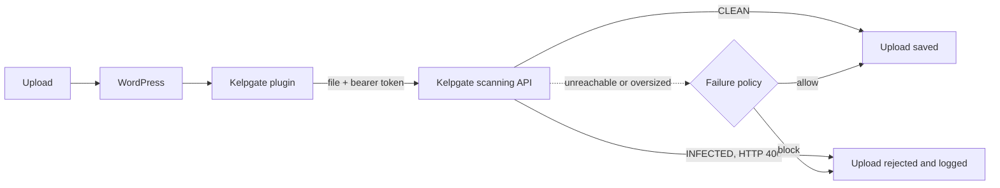

# Kelpgate Malware Scanner for WordPress

**Stop infected uploads before they reach your site.**

Kelpgate Malware Scanner checks every file uploaded to WordPress against the Kelpgate scanning service and blocks infected files before they are saved. It covers the Media Library, form plugins and custom upload handlers, and gives administrators a clear record of what was blocked.

> This plugin is open source under GPL-2.0-or-later. It is a client for the Kelpgate scanning service, a hosted commercial product that is not part of this repository. You need a Kelpgate account to use it.

## Contents

[Why Kelpgate](#why-kelpgate) · [How it works](#how-it-works) · [Install](#install) · [Configuration](#configuration) · [Failure policy](#failure-policy) · [Security and privacy](#security-and-privacy) · [Compatibility](#compatibility) · [Verify your setup](#verify-your-setup) · [Troubleshooting](#troubleshooting) · [Release process](#release-process) · [Contributing and security](#contributing-and-security) · [License](#license)

## Why Kelpgate

| | |
| --- | --- |
| **Blocks at the door** | Uploads are scanned during the upload itself. An infected file is rejected and never lands in `wp-content/uploads`. |
| **Broad coverage** | Hooks WordPress's own upload pipeline and also inspects raw `$_FILES` uploads sent to other endpoints, such as form plugins and custom handlers. |
| **Predictable failure behaviour** | You choose what happens when the scanner is unreachable or a file is too large: reject (fail-closed) or accept (fail-open). |
| **Credentials stay out of the database** | Set the API URL and client credentials as constants in `wp-config.php`. Saved secrets are never echoed back into the settings page. |
| **Accurate client IPs** | Incident records store the visitor's address, honouring `X-Forwarded-For` only from proxies you trust. |
| **Clean removal** | Deleting the plugin removes its settings, incident log and cached tokens. |

## How it works



1. The plugin obtains an OAuth 2.0 access token with your client credentials. Tokens are cached and renewed shortly before they expire.
2. The file is sent to the scanning API over HTTPS.
3. Only a verdict of infected (HTTP 406) blocks a file. The rejection and its details are recorded in the incident log (the last 50 incidents are kept).

## Install

**Requirements:** WordPress 5.8 or later, PHP 7.4 or later, and a Kelpgate account (client ID and client secret from the Kelpgate Console).

1. Download `kelpgate-wordpress-plugin.zip` from the [latest release](https://github.com/JustBots-Labs/kelpgate-wordpress-plugin/releases/latest). Use that file, not the "Source code" archives.
2. In WordPress admin, go to **Plugins > Add New > Upload Plugin**, choose the zip, then **Install Now** and **Activate**.
3. Open **Settings > Kelpgate Malware Scanner**, enter the API URL, token URL, client ID and client secret, and select **Test connection**.

Each release includes a `.sha256` file so you can verify the download.

## Configuration

Settings can be saved in the admin page or defined as constants in `wp-config.php`. A constant takes precedence over the saved value and keeps the credential out of the database.

```php
define('KELPGATE_API_URL',       'https://api.example.com');
define('KELPGATE_TOKEN_URL',     'https://auth.example.com/oauth2/token');
define('KELPGATE_CLIENT_ID',     'your-client-id');
define('KELPGATE_CLIENT_SECRET', 'your-client-secret');

// Behind a load balancer or CDN: comma-separated IPs/CIDRs whose X-Forwarded-For header is trusted.
define('KELPGATE_TRUSTED_PROXIES', '10.0.0.0/8');
```

| Setting | Where | Default | Notes |
| --- | --- | --- | --- |
| API URL, token URL | Admin page or constant | none | Must be HTTPS (plain HTTP is accepted only for `localhost`). |
| Client ID, client secret | Admin page or constant | none | Leave the secret field blank to keep the saved one. |
| Failure policy | Admin page | block | See below. |
| Maximum file size | Admin page | 50 MB | 1 to 500 MB. |
| Trusted proxies | `KELPGATE_TRUSTED_PROXIES` or the `kelpgate_trusted_proxies` filter | loopback and private ranges | Controls which proxies may supply `X-Forwarded-For`. |

## Failure policy

| Situation | Fail-closed (`block`, default) | Fail-open (`allow`) |
| --- | --- | --- |
| Scanner unreachable or returns an error | Upload rejected | Upload accepted |
| Authentication fails | Upload rejected | Upload accepted |
| File larger than the maximum size | Upload rejected | Upload accepted |
| Not enough PHP memory to buffer the file | Upload rejected | Upload accepted |
| Plugin not configured yet | Upload accepted | Upload accepted |

Choose fail-closed where blocking malware matters more than availability, and fail-open where uploads must keep working during an outage. Each file is read into memory for transmission, so keep PHP's `memory_limit` comfortably above your largest allowed upload.

## Security and privacy

- **What leaves your server:** the uploaded file and its name are sent to the API URL you configure, over HTTPS. Nothing else about your site is sent.
- **Transport:** API and token endpoints must use HTTPS.
- **Access control:** the settings page and connection test require an administrator and a valid nonce.
- **Secrets:** saved secrets are never written into the page HTML. Use constants to keep them out of the database entirely.
- **Rate limiting:** raw upload inspection is limited to 20 files per minute per client address.
- **Token handling:** access tokens are cached and refreshed ahead of expiry. A rejected token is discarded and retried once.
- **Data retained:** an incident record (time, file name, signature, SHA-256, client IP, user ID) for the last 50 blocked uploads. It is removed on uninstall.

To report a vulnerability, please open a private security advisory on this repository.

## Compatibility

Every combination below was installed on a real WordPress and checked: a clean upload is accepted, an EICAR test upload is rejected, and both failure policies behave as set. The scanning API was simulated for these runs.

| WordPress | PHP |
| --- | --- |
| 5.8 | 7.4, 8.0 |
| 6.1 | 7.4 |
| 6.4 | 8.0, 8.1, 8.2 |
| 6.9 | 8.1, 8.2, 8.3, 8.4 |

All source files also lint cleanly on PHP 7.4 through 8.4. Combinations not listed have not been tested.

## Verify your setup

Save the standard EICAR test string as `eicar.txt` and upload it through **Media > Add New**:

```
X5O!P%@AP[4\PZX54(P^)7CC)7}$EICAR-STANDARD-ANTIVIRUS-TEST-FILE!$H+H*
```

The upload is refused and an entry appears in the incident list on the settings page.

## Troubleshooting

| Symptom | Likely cause |
| --- | --- |
| Every upload is rejected | The scanner is unreachable or credentials are wrong while the failure policy is `block`. Use **Test connection**. |
| Nothing is ever blocked | The plugin is not configured (all four connection values are required), or the policy is fail-open during an outage. |
| "Installed more than once" notice | Two copies are present. Deactivate and delete the duplicate under Plugins. |
| Incident log shows a proxy address | Add your load balancer or CDN network to `KELPGATE_TRUSTED_PROXIES`. |
| Large files rejected | Raise the maximum file size and ensure PHP `memory_limit` is at least about twice the file size. |

For extra detail, enable `WP_DEBUG` and `WP_DEBUG_LOG`; blocked uploads are then written to `wp-content/debug.log`.

## Release process

`./package.sh` builds `kelpgate-wordpress-plugin.zip` with a single top-level `kelpgate-wordpress-plugin/` folder, verifies the layout and writes a SHA-256 file. Pushing a `vX.Y.Z` tag that matches the plugin version runs the release workflow, which lints on PHP 7.4, builds the zip and publishes the release.

## Contributing and security

Bug reports and pull requests are welcome; see the [contributing guide](https://github.com/JustBots-Labs/.github/blob/main/CONTRIBUTING.md). To report a vulnerability, follow the [security policy](https://github.com/JustBots-Labs/.github/blob/main/SECURITY.md) and report it privately. For help, see [getting help](https://github.com/JustBots-Labs/.github/blob/main/SUPPORT.md).

## License

GPL-2.0-or-later. See [LICENSE](LICENSE).
